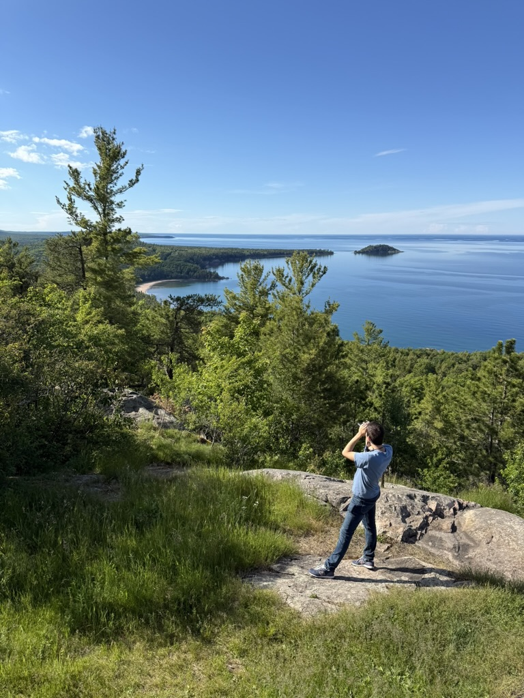

::::: columns
::: {.column width="40%"}
{width="100%"}

:::

::: {.column width="60%" style="padding-left: 2em;"}
I am an ecologist and ornithologist interested in understanding the ecological and evolutionary processes that shape fundamental patterns of biodiversity and animal movement. I integrate field work, comparative methods, and computational ecology to understand how the movements of seasonal migrants influence their geographic distributions, along with the evolutionary and ecological consequences of differing migratory strategies.

I am currently a PhD candidate in Ecology & Evolutionary Biology at the University of Michigan. Before my graduate work, I earned a B.S. in Ecology & Evolutionary Biology at Yale University, and worked as an Avian Field Technician at the USGS Eastern Ecological Science Center.
:::
:::::
