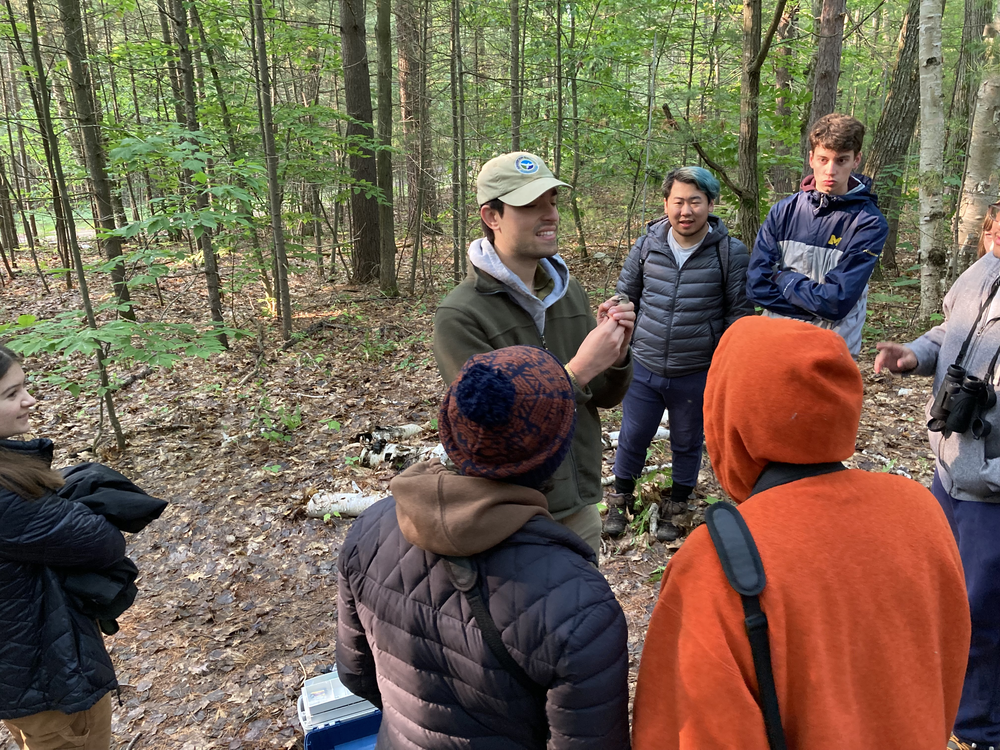
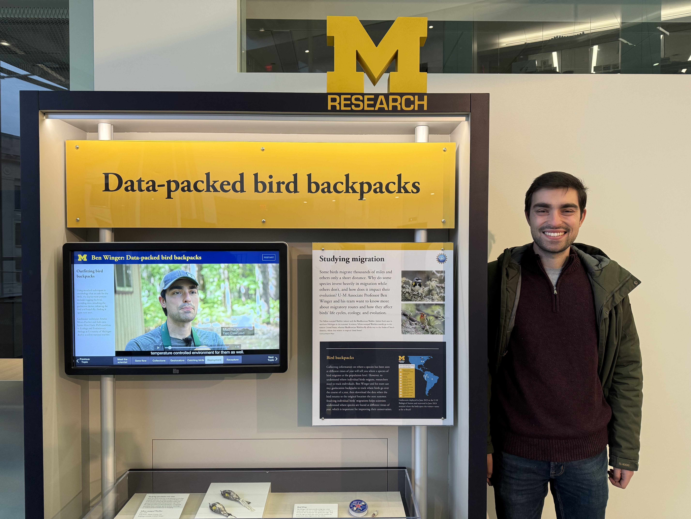
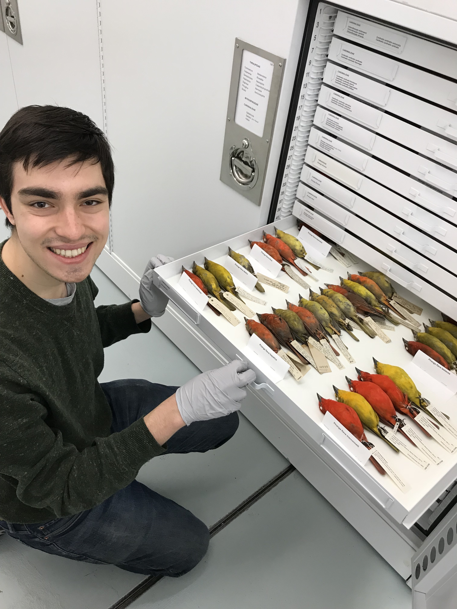
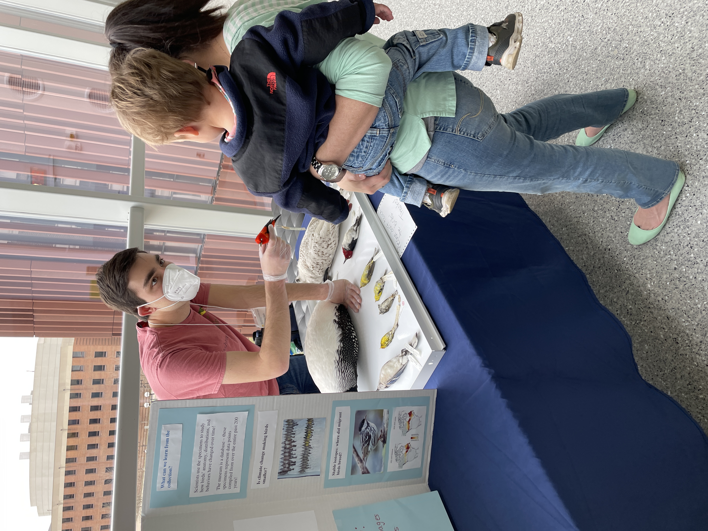
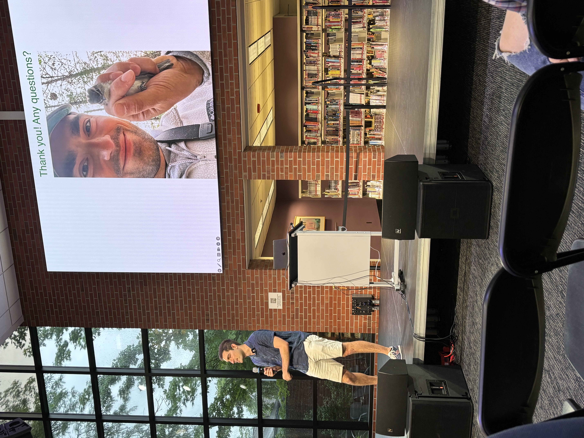

## Teaching Experience

I believe that one of the most profound impacts I can have as a scientist is through instruction and mentorship. I have served as a graduate student instructor for four courses at the University of Michigan: EEB 548 (Population & Community Ecology), EEB 433 (Ornithology), BIO 281 (General Ecology), and BIO 171 (Introduction to Ecology & Evolution). I earned an Outstanding Graduate Instructor Award for my teaching in EEB 548.

I am always seeking to improve my instruction and pedagogy. As a graduate student, I completed a semester-long course on scientific pedagogical practices. In addition, I have worked closely with the University of Michigan Center for Teaching and Learning. I earned a Graduate Teaching Certificate through pursuing additional professional development as an instructor. I also completed the University of Michigan Preparing Future Faculty Program to train in syllabus design and inclusive teaching practices.

Finally, I am passionate about making statistics, data science, and coding accessible to life science students. These are essential skills in the biologist toolkit that nonetheless prove initially intimidating to many students. I have created a syllabus for a course entitled “Spatial and Quantitative Ecology in R” designed to improve statistical reasoning skills for life science students, which I hope to teach in the future.

## Outreach

One of the great joys of science is the opportunity to make your passions accessible to a variety of audiences. Here’s some of what I’ve been up to recently!

### Coverage

Along with my PhD advisor Ben Winger, I partnered with videographers from the University of Michigan Museum of Zoology to create an interactive research kiosk, titled "Data-packed bird backpacks", explaining the process of tracking birds with geolocators. Check out the videos [here](https://lsa.umich.edu/ummnh/visitors/exhibits/virtual-research-stations/ben-winger-data-packed-bird-backpacks.html)!

My geolocation research was [also covered by](https://lsa.umich.edu/umbs/news-events/all-news/search-news/u-m-research-team-recaptures-songbird-sensors-to-unlock-migratio.html) the University of Michigan Biological Station: check it out to learn more about what we learn from tracking songbirds.

### Museum-based Education

Natural history museums were my own introduction into the field of ornithology, and made me realize that my lifelong love for birds could turn into an academic pursuit. I have found natural history museums to be a fantastic avenue to reach people of all ages through captivating, close-up looks at the creatures they know and love. As a University of Michigan Museum of Natural History Science Communication Fellow, I’ve had the opportunity to lead behind-the-scenes collections tours, run tabletop displays of museum specimens, and give accessible presentations of museum-based research to families. 

<table style="width: 75%; margin: 0 auto; border: none;">
  <tr>
    <td style="width: 50%; text-align: center; border: none;">
      
    </td>
    <td style="width: 50%; text-align: center; border: none;">
      
    </td>
  </tr>
</table>

### Classroom Education

I’ve had lots of fun bringing birds and science to the K-12 classroom. Most recently, I served as a Science Olympiad coach for a team of second graders competing in the “Feathered Friends” division. I’ve also visited the Detroit Public Schools through the Write Like a Scientist Program, along with Dearborn High School as a University of Michigan DNA Day Instructor. Before that, I served as a science mentor in a New Haven magnet school and led first graders on field trips to local saltmarsh habitats. Please feel free to contact me with any opportunities to connect classrooms to science and nature!

### Talks

It’s always a treat to chat birds and ornithology with other nature-lovers. Check out some of my recent public talks:

- [“Tracking Songbird Migration Using Geolocators”](https://www.youtube.com/watch?v=nk9g4ahxo6U) (Washtenaw Bird & Nature Alliance)
- [“Tern Research in the Chesapeake Bay”](https://www.youtube.com/watch?v=nk9g4ahxo6U) (Washtenaw Bird & Nature Alliance)

