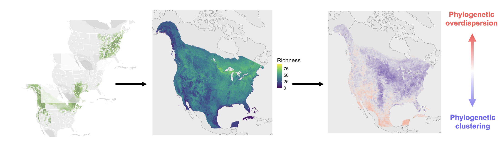
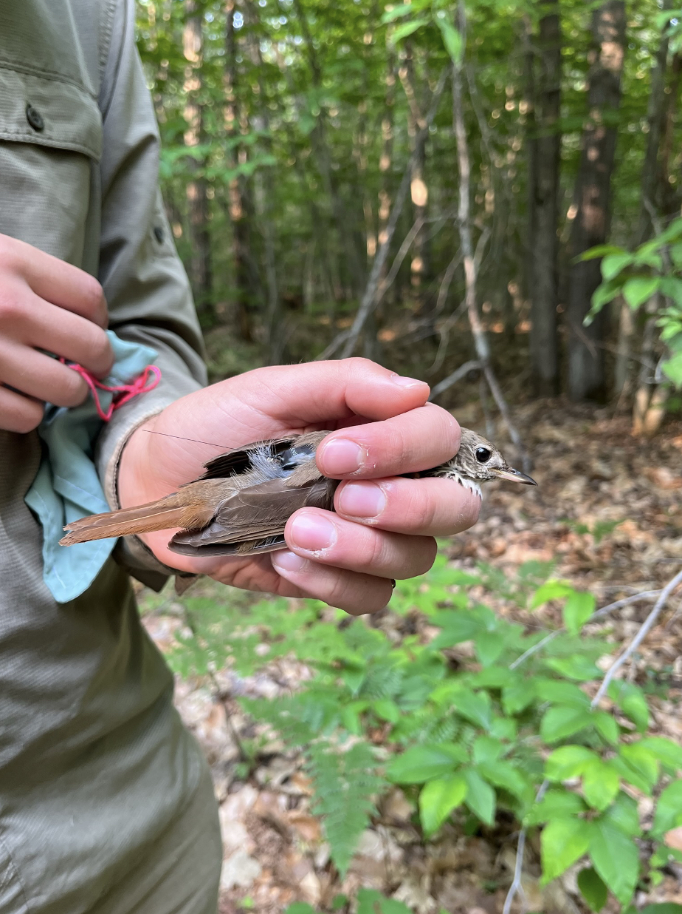
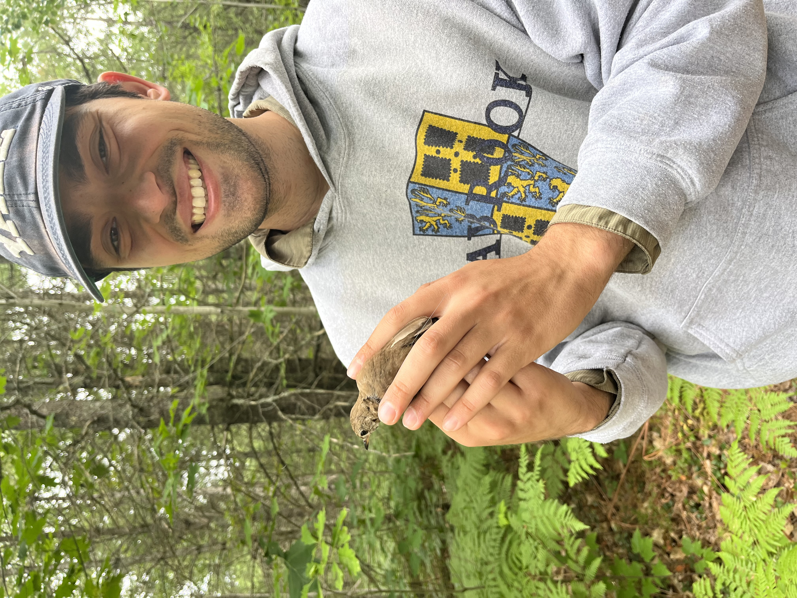
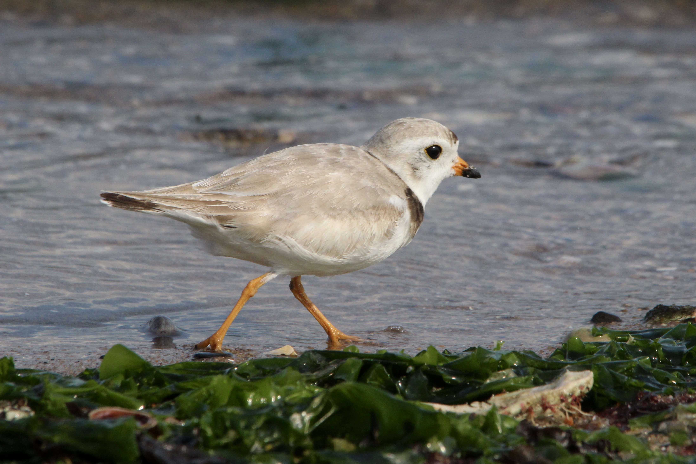

I am fascinated by geographic patterns in biodiversity, and the combination of ecological and evolutionary factors that shape the distribution of global biodiversity. Seasonal migration poses an especially rich opportunity to investigate these questions, as the annual movements of migratory animals connect organisms, communities, and ecosystems throughout the world.

My research sits at the intersection of macroecology, community ecology, and animal movement. I explore the ecology and evolution of bird migration across spatial scales, ranging from the movements of individuals to the communities they enter and exit to continental-scale patterns in biodiversity.

## **The macroecology and community ecology of seasonal migration**

The seasonal influx and exodus of migratory birds profoundly reshapes local communities by altering which species are present. In the process, seasonal migration not only influences community diversity levels, but also introduces new combinations of species interactions. Species are shifting their geographic distributions and phenologies in response to anthropogenic change, generating new communities in the process; it is therefore critical to understand how changes to species interactions and diversity levels affect biological communities.

To better understand the effects of migrants on their communities, I integrate phylogenetic data, community ecology methods, and citizen science datasets to investigate how seasonal migration restructures species interactions. I found that as seasonal migration rearranges the species identities and diversity of bird communities, migrants also affect the factors driving the assembly of these communities. My results show that bird communities can accommodate the arrival of many migratory species in the same family, but this extra diversity also promotes heightened competition among the very closest relatives.

  
  

    Seasonal migration rearranges biodiversity, and in the process causes a continental-scale redistribution of patterns in phylogenetic dispersion. Hack et al. 2026, <em>Journal of Animal Ecology</em>.
  

## **The migratory geography of annual cycle dynamics**

The timing of an organism’s annual cycle is governed by its relative investment in reproduction versus survival. While tracking technology has allowed the study of migration at unprecedented detail, we have historically lacked a comparative understanding of how the geography of seasonal migration relates to the pacing of birds’ annual cycles.

To assess the relationships between migratory geography and timing, I have harnessed geolocator tracking data to conduct a comparative assessment of annual cycle pacing in North American songbirds. I’ve attached nearly 200 geolocators to seven species of songbirds breeding in Northern Michigan, and integrated my original field data into a larger dataset curated from published migration tracking studies. I show migration distance to strongly predict the timing and pacing of migratory birds’ annual cycles. My results demonstrate that given the information of the location and duration of a bird’s breeding season, we can predict its migration distance, wintering destination, and overall pacing of its travels. These findings illustrate critical life history tradeoffs in annual cycle allocation.

<table style="width: 75%; margin: 0 auto; border: none;">
  <tr>
    <td style="width: 50%; text-align: center; border: none;">
      
    </td>
    <td style="width: 50%; text-align: center; border: none;">
      
    </td>
  </tr>
</table>

## **Consequences of climate change and urbanization for migratory bird communities**

Patterns of biodiversity and animal movement are likely subject to profound changes under ongoing climate change and urbanization. I am currently designing projects to investigate how geographic patterns in avian biodiversity, community compositions, and seasonal interactions will be affected as climate and land use conditions propagate disruptions to bird communities. Stay tuned for further updates!

  
  

